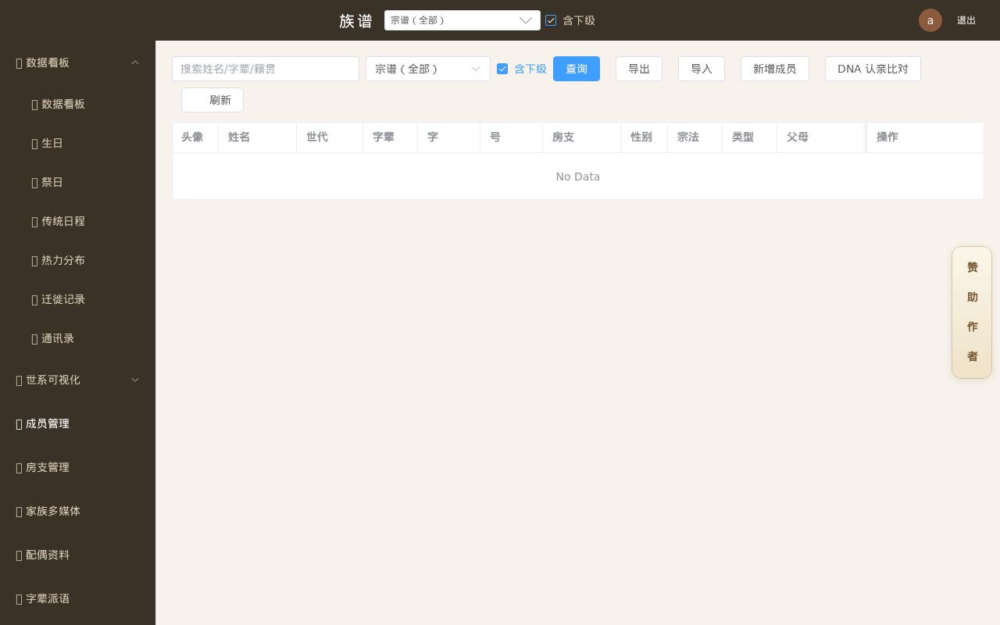

**仓库：** `zupu`　**许可证：MIT**

# 族谱系统

一个开源的家族谱牒数字化系统：世系图、牒记式谱书、苏式垂珠体、成员档案、谱头文化、祠堂 3D、知识库联动与 PDF 导出。

> 本仓库为源码版，不包含任何授权/激活/混淆逻辑；数据与更新源均本地可控。

## 功能

- 世系可视化：宝塔式、苏式垂吊/垂丝、苏氏垂珠体、世代分层图、传代树
- 谱书：竖排牒记式、横版牒记式、谱书封面设计、A3/A4 PDF、续格不裁字、五世一图
- 谱头文化：谱序、族规、祖训、字辈、名人传记、家族大事记
- 成员管理：房支、配偶、多媒体、资料来源、导入导出、数据体检
- 祠堂/祠宇志/茔墓志、家族知识库联动
- 按房支筛选，支谱随顶部选择切换
- 纯本地部署，数据不上传云端

## 截图




## 快速开始

### Docker

```yaml
services:
  familytree:
    image: alpine:3.21
    container_name: familytree
    ports: ["8888:8080"]
    environment:
      FAMILY_TREE_DATA_DIR: /data
      FAMILY_TREE_PORT: "8080"
      FAMILY_TREE_ADMIN_USER: admin
      FAMILY_TREE_ADMIN_PASS: admin123
    volumes:
      - ./data:/data
      - ./web:/app/web:ro
      - ./familytree:/app/familytree:ro
    entrypoint: ["/app/familytree"]
```

默认端口 **8888**（可在环境变量中修改），初始账号 `admin / admin123`。

### fnOS fpk

使用 `安装包/族谱系统/...-fnos.fpk` 安装；fpk 默认端口 **8888**，`checkport=false`，安装向导可改。

## 构建

```bash
cd frontend && pnpm install && pnpm build
cd ../backend
CGO_ENABLED=1 CC=musl-gcc go build -tags sqlite_fts5 -trimpath \
  -ldflags "-linkmode external -extldflags -static -s -w" -o familytree .
```

- 无 garble / 加壳 / 字符串加密；
- SQLite 需要 CGO，因此使用 `CGO_ENABLED=1` + musl 静态链接；
- 前端 `pnpm build` 产物放 `web/`。

## 数据与隐私

- 数据只存在本机/自己的服务器；
- 不上传云端；备份、导出由用户掌控；
- 默认更新源可配置，也可关闭在线更新。

## 赞助

本项目由业余爱好者利用工作之余维护。若对您有帮助，欢迎扫码赞助或加微信交流：

| 赞助支持 | 加我微信 |
|---|---|
|  |  |

赞助完全自愿，不影响功能使用。

## 关于我们

本系统由业余爱好者利用工作之余独立开发维护，功能迭代或有延迟，还望海涵。纯本地部署，数据只存在您自己的服务器上，绝不上传云端。

## 声明

- 业余维护，不保证 SLA；
- 使用前请自行备份数据；
- 生产环境请修改默认密码并配置 HTTPS/反向代理。

## 许可证

本项目采用 **MIT** 许可证，详见 [LICENSE](LICENSE)。

> 说明：赞助二维码为开发者本人所有，二次开发者请自行替换。
